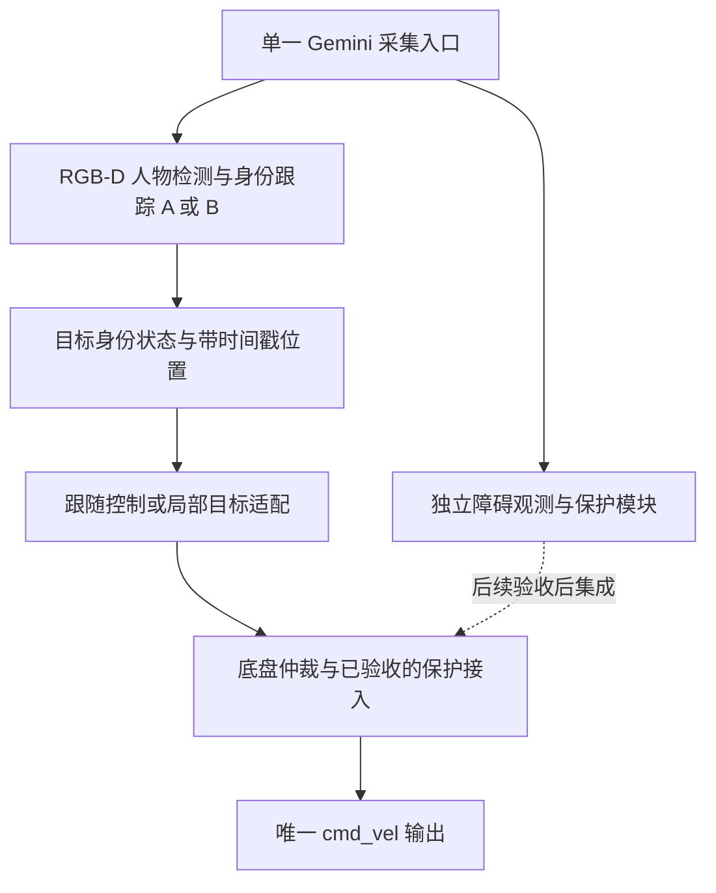

# 视觉跟随方案调研与选型

> 本文保留改造前的调研快照及历史代码链接。已采用 BoT-SORT 成熟核心 + OSNet + RGB-D 约束 + 质量感知身份管理，当前实现见 [人员跟随接口](../reference/人员跟随.md)，旧 demo 已移除。

调研日期：2026-10-22。状态：选型建议，尚未实现或完成候选方案的本机性能对比。

本报告依据项目源码、已安装依赖、作者论文、官方仓库与文档。当前代码基线为 `a01d2db` 加工作区中的避障开发和文档整理改动。只进行了只读环境检查和既有无硬件测试，没有打开相机、安装模型、发布速度或改变服务。

## 结论

针对本机 Orin NX、Gemini 305、ROS 2 Humble 和现有底盘仲裁，优先保留当前 RGB-D 与控制接口，采用成熟开源跟踪组件组成跟随系统。推荐的两个候选是：

1. **方案 A：YOLOv8n TensorRT FP16 + Ultralytics BoT-SORT + 显式 ReID + RGB-D。** 当前最优先落地，改动和依赖迁移较小，先解决延迟与移动相机下的短时身份保持。
2. **方案 B：相同检测器 + BoxMOT Deep OC-SORT + OSNet 行人 ReID + 受约束的目标身份记忆 + RGB-D/里程计。** 面向多人交叉、转身及遮挡恢复的增强候选，集成与资源管理成本较高。

这里的“最优”是本项目约束下的工程优先级，不是已测出的算法排名。两者都是待集成的组合方案，不是下载即可运行的完整机器人跟随产品。是否选 B 替代 A，应由相同输入、本机并发负载下的身份错误率与延迟决定；不能直接用不同检测器的 MOT 榜单排名判断。[BoxMOT 官方比较说明](https://mikel-brostrom.github.io/boxmot/compare/)

## 本机约束与现有基础

| 项目 | 本次核实结果 | 对选型的影响 |
| --- | --- | --- |
| 计算设备 | 设备树报告 Jetson Orin NX；系统可见内存约 7.43 GiB，属于约 8 GB 配置 | 使用小型模型、批量 1，必须为 ROS、Web、避障保留资源 |
| 系统推理库 | L4T R36.5.0；已安装 `libnvinfer10 10.3.0.30-1+cuda12.5` | 可优先验证 TensorRT；系统库存在不等于 Python 绑定及推理链已可用 |
| demo Python | Python 3.10，NumPy 1.26.4，Ultralytics 8.3.253，PyTorch 2.5.1 | 本机 torch 的 `version.cuda=None`，当前环境是 CPU 构建，仅改 `--device 0` 不足以启用 CUDA |
| 摄像头 | Gemini 305；RGB 640×480，RGB-D 对齐；目前使用倒置修正 | 保留已打通的 SDK；不因上游使用 RealSense 就换相机 |
| 外参 | x=0.575、y=0.2775、z=0.727 m，yaw=-30°；光心、俯仰和畸变尚未完整标定 | 低机位、偏置视野和截断人体必须纳入实际视频评测 |
| 运动边界 | 跟随经 `/follow_cmd_vel` 进入 `base_control_router`，唯一最终输出为 `/cmd_vel` | 新方案继续遵守仲裁、接管、取消与输入超时规则 |
| 导航与避障 | 自研导航；独立 MRPT 避障仍是观测原型，尚未接入底盘保护 | 人员身份识别与避障保持分工；不能把观测建议速度直接当成已验收保护 |

证据入口：[demo 说明](https://github.com/Flownist/nav-2026/blob/a01d2db682b377b8810688124954e88dbb42445a/demo/person_follow/README.md)、[依赖清单](https://github.com/Flownist/nav-2026/blob/a01d2db682b377b8810688124954e88dbb42445a/demo/person_follow/requirements.txt)、[跟随入口](https://github.com/Flownist/nav-2026/blob/a01d2db682b377b8810688124954e88dbb42445a/demo/person_follow/run.py)、[跟随核心](https://github.com/Flownist/nav-2026/blob/a01d2db682b377b8810688124954e88dbb42445a/demo/person_follow/core.py)、[避障开发记录](../开发与验证.md#独立避障观测版)。环境信息由本机只读检查取得，历史相机性能来自 demo 文档，不是本次重新测得。

## 开源候选筛选

筛选顺序：可检查的代码与模型、身份保持机制、移动相机适配、部署依赖、系统边界及可复现验证。论文存在、README 宣称高帧率、GitHub 星数，均不足以单独证明适合本机。

| 项目 | 值得采用的能力 | 本项目取舍 |
| --- | --- | --- |
| [BoT-SORT](https://github.com/NirAharon/BoT-SORT) / [Ultralytics 固定版本](https://github.com/ultralytics/ultralytics/tree/v8.3.253/ultralytics/trackers) | 运动关联、相机运动补偿、可选外观特征 | 入选 A；现有依赖中已有实现，但必须显式启用 ReID |
| [Deep OC-SORT 作者实现](https://github.com/GerardMaggiolino/Deep-OC-SORT) / [BoxMOT 实现](https://mikel-brostrom.github.io/boxmot/trackers/deepocsort/) | 观测中心运动更新、自适应外观关联、移动相机补偿 | 入选 B；用维护中的组件接口评测，不直接搬原研究环境 |
| [BoostTrack / BoostTrack++](https://github.com/vukasin-stanojevic/BoostTrack) | 利用轨迹信息改善检测关联，具有公开论文与代码 | 保留为离线对照，不因榜单成绩直接替换；仍需完整身份管理、深度和控制层 |
| [OCL-RPF](https://github.com/MedlarTea/OCL-RPF) / [OCLReID](https://github.com/MedlarTea/OCLReID) | 专门研究机器人目标人物重识别与在线持续学习 | 借鉴目标记忆和恢复评测；原环境为 ROS 1、旧版 PyTorch/MMCV，仓库仍列有效率和代码发布 TODO，不作为当前整套移植首选 |
| [Koide monocular_person_following](https://github.com/koide3/monocular_person_following) | 机器人坐标系跟踪、UKF、在线人物身份学习；有 Jetson 部署经验 | 借鉴几何和身份分层；原验证环境是 Xavier/JetPack 4.5.1，依赖旧 TensorFlow/tf-pose，且我们已有真实深度 |
| [SPENCER people tracking](https://github.com/spencer-project/spencer_people_tracking) | 多传感器人员跟踪、运动模型、遮挡状态与协方差表达 | 借鉴状态消息和融合设计；公开支持 ROS 1 Kinetic/Melodic/Noetic，整体迁移范围大 |
| [Nav2 Following Server](https://docs.nav2.org/rolling/tutorials/general_tutorials/navigation2_dynamic_point_following/navigation2_dynamic_point_following/) | 动态目标跟随控制、距离保持、恢复状态 | 是控制组件而非视觉身份方案；官方页面是新版本资料，不能当作本项目 Humble 即装即用功能。现有自研控制无需因此整体切换 Nav2 |
| [person-following-sys](https://github.com/fillzer96/person-following-sys) | 人物登记、特征库、颜色与 OpenCLIP 两阶段匹配 | 借鉴登记和特征质量管理；README 的 RealSense、Thor/JetPack 7 路线与本机不同，缺少本机资源和对比证据，未入选 |

FollowMe 的[作者论文](https://arxiv.org/abs/2311.12992)讨论 ReID、手势和避障联动，但本次没有确认一套与论文对应、可直接复现的完整官方代码入口，因此不将论文描述等同于可采用的开源产品。

本次查到的 BoxMOT master 为 `baf75939e593bb36eae43707ec38d0c52600a2f2`，提交日期 2026-10-17；Deep OC-SORT 作者仓库 main 为 `6bb51d027b137233f5c520b6fcc4f2ae387a6ba9`，提交日期 2023-05-06。这些是调研快照，不是已验证的安装版本。

## 方案 A：现有依赖上的渐进升级

### 组成与收益

- 保留 YOLOv8n，先导出本机兼容的 TensorRT FP16、batch=1 引擎，使检测器变化可控。对 320 与 640 输入做同场景精度/延迟比较，再决定尺寸。
- 将 ByteTrack 换为当前 Ultralytics 已包含的 BoT-SORT，使用其相机运动补偿和外观关联；检测准入与新身份确认采用不同阈值。
- 启用显式的外观编码器。A 使用现有实现支持的轻量分类特征编码器作为起点；它不是经过专门行人身份训练的 OSNet，跨视角判别能力必须实测。
- RGB-D 保留躯干有效深度检查，并加入有界的时序滤波、深度跳变拒绝。增加登记、跟随、丢失停车、候选复核、取消的状态管理。
- 保留独立输出 watchdog、超声近障门控和底盘仲裁；人物失踪时停车等待确认，不用扩大缓存时间替代身份确认。

依据：[BoT-SORT 作者论文](https://arxiv.org/abs/2206.14651)、[v8.3.253 配置](https://github.com/ultralytics/ultralytics/blob/v8.3.253/ultralytics/cfg/trackers/botsort.yaml)、[TensorRT 官方集成说明](https://docs.ultralytics.com/integrations/tensorrt/)。

### 已核实的部署陷阱

1. `botsort.yaml` 默认 `with_reid: False`。只换 YAML 文件不会得到身份重识别。
2. 本机 v8.3.253 的 `model: auto` 在无法挂接原生 PyTorch 检测特征时，回退到 `yolo11n-cls.pt`。TensorRT 检测引擎不能被假定仍免费复用检测特征；要显式管理外观模型、输出 embedding 和推理后端，避免意外下载或 CPU 回退。[固定版本源码](https://github.com/ultralytics/ultralytics/blob/v8.3.253/ultralytics/trackers/track.py)
3. 当前 CPU torch 环境不能直接承诺运行 TensorRT+ReID 全链。新建隔离推理环境，核实 Jetson CUDA torch、TensorRT Python 绑定及 encoder 兼容性后再部署。
4. 在线最新版 Ultralytics 文档已包含更多跟踪器，但本机固定版本只提供 ByteTrack/BoT-SORT。方案 A 不以升级整个 Ultralytics 为前提。
5. 引擎应按目标 GPU 和运行时生成并实测，不能直接复用其他机器的 `.engine`。[TensorRT 部署说明](https://docs.ultralytics.com/integrations/tensorrt/)

### 适用边界

A 最适合先验证单人、少量交叉和短时遮挡，依赖变化较少。它没有天然解决长期身份丢失或相似衣着问题；自动重新绑定必须结合外观、空间约束和连续观测。首次落地可以保守地要求显式重新确认。

## 方案 B：专用身份特征与目标记忆

### 组成与收益

采用与 A 相同的检测器及输入，BoxMOT Deep OC-SORT 做帧间关联，OSNet 专门提取行人身份特征。先评测 `osnet_x0_25`，有明确收益且预算允许时再比较 `x0_5`。选择经过行人 ReID 训练的权重，不能把仅 ImageNet 预训练模型误当作成品人物身份模型。[Torchreid 模型库](https://kaiyangzhou.github.io/deep-person-reid/MODEL_ZOO.html)

Deep OC-SORT 的外观关联与相机补偿是上游能力；下面这些是本项目需要新增的系统逻辑，不是 BoxMOT 已自动提供的保证：

- 将“登记人物身份”与 MOT 的临时整数 ID 分开保存，允许轨迹失效后重新产生 ID。
- 保存容量有界的多视角高质量特征；严重遮挡、模糊或身份有歧义时不更新，避免把路人写进目标记忆。
- RGB-D 测量变换到连续 `odom` 坐标系，结合时间戳和不确定度做空间可达性检查；机器人转弯时不能只比较图像框的距离。
- 恢复时同时满足外观相似度、第一/第二候选差距、空间约束和连续多帧确认；相似衣着或多人均匹配时保持停车。
- 只对候选人物做有预算的特征提取，不把大型 CLIP、在线反向传播或整套 OCL 训练塞入 8 GB 主机的实时控制链。

该方案的合理预期是改善复杂身份关联，不能预先宣称比 A 高多少成功率或保证长遮挡恢复。[Deep OC-SORT 论文](https://arxiv.org/abs/2302.11813)、[BoxMOT 实现说明](https://mikel-brostrom.github.io/boxmot/trackers/deepocsort/)

### 兼容性与成本

调研快照中的 BoxMOT 自报 25.0.0，Python 要求覆盖 3.10，但核心依赖要求 NumPy >=2.2；本机 demo 固定 NumPy 1.26.4。其可选 YOLO 依赖还要求更高版本 Ultralytics。因此不能直接安装进 `.venv-person-follow`。应隔离环境并验证 ROS/OpenCV 交互，或选定经测试的兼容版本；不通过忽略依赖冲突宣称兼容。[BoxMOT 依赖声明](https://github.com/mikel-brostrom/boxmot/blob/baf75939e593bb36eae43707ec38d0c52600a2f2/pyproject.toml)

检测和特征模型可分别导出，但模型格式支持不代表已在本机达到实时。B 需要额外的裁剪、embedding、匹配和记忆管理预算，多人场景尤其要测尾延迟与内存。

原版 Deep OC-SORT 仓库标注 MIT，Torchreid 提供 OSNet 及导出入口；本次推荐集成路径使用的 BoxMOT 是 AGPL-3.0，现有 Ultralytics 也是 AGPL-3.0。不能用算法作者仓库的许可证替代实际引入实现和权重的条款。[Deep OC-SORT](https://github.com/GerardMaggiolino/Deep-OC-SORT)、[BoxMOT LICENSE](https://github.com/mikel-brostrom/boxmot/blob/master/LICENSE)、[Ultralytics LICENSE](https://github.com/ultralytics/ultralytics/blob/v8.3.253/LICENSE)

## 两个方案与当前 demo 对比

| 维度 | 当前 follow demo | 方案 A，待实现 | 方案 B，待实现 |
| --- | --- | --- | --- |
| 感知执行 | YOLOv8n，CPU，320 输入 | 同模型 TensorRT FP16 | 与 A 共用检测基线，额外专用 ReID 推理 |
| 关联线索 | ByteTrack 的运动/框关联 | BoT-SORT 运动、相机补偿、外观 | Deep OC-SORT 自适应外观与运动关联 |
| 目标身份 | 只锁整数 ID | 外观复核与保守恢复 | 专用行人特征、多视角记忆和重绑定 |
| 深度与几何 | 躯干 ROI 中位数，单帧位置 | 有界滤波、有效深度与跳变检查 | 同样检查，再结合 odom 和不确定度 |
| 丢失行为 | 停车，等待原 ID；换人要重启 | 停车、候选确认、显式重选 | 停车、身份记忆检索、多条件恢复 |
| 多人启动 | 等待只剩一个人 | 明确登记目标 | 明确登记，并建立特征记忆 |
| 控制 | 距离/方位比例控制 | 加状态与平滑控制，保留仲裁 | 相同控制边界，利用较稳定的目标状态 |
| 绕障 | 四路超声近障停车，无绕行 | 仍需独立避障集成 | 同样需要，ReID 本身不提供绕障 |
| 工程成本 | 已有基线 | 较低，优先做 | 较高，需环境隔离和额外评测 |

## 当前 demo 的具体不足

### 1. ID 锁定不等于锁定同一个人

`TargetLock.select()` 仅检查整数 ID。它可以阻止主动改选另一个 ID，但不能发现跟踪器已经把原 ID 错配给了路人。同一个人重新出现并获得新 ID 时又无法恢复。这是多人交叉中最重要的身份缺口。[core.py](https://github.com/Flownist/nav-2026/blob/a01d2db682b377b8810688124954e88dbb42445a/demo/person_follow/core.py)

### 2. 当前阈值削弱了 ByteTrack 的低分框恢复

`run.py` 的 `model.track(... conf=.5 ...)` 在跟踪前过滤检测框；本机 `bytetrack.yaml` 为 `track_high_thresh=0.25`、`track_low_thresh=0.1`。因此 0.1–0.25 的第二阶段候选已被上游过滤，遮挡导致置信度下降时更容易断轨。应分离低分关联准入与高分身份登记，先做视频回放对比，不能仅为保轨而放宽人物确认条件。[run.py](https://github.com/Flownist/nav-2026/blob/a01d2db682b377b8810688124954e88dbb42445a/demo/person_follow/run.py)

### 3. CPU 延迟已经接近数据失效期限

历史记录是 10 秒处理 33 帧，多数 230–340 ms，少数超过 350 ms；当前默认依然是 CPU。20 Hz 输出线程不等于 20 Hz 的新视觉测量。

`MotionOutput` 从帧接收时刻计算 350 ms 有效期：若推理用了 340 ms，结果发布后只剩约 10 ms 预算，下一帧未完成就可能再次停车，造成间歇式输出。此处是依据时序代码推导的风险，不是本次实际行驶观测。应优化端到端延迟，不能简单延长停车超时。[输出与推理代码](https://github.com/Flownist/nav-2026/blob/a01d2db682b377b8810688124954e88dbb42445a/demo/person_follow/run.py)

### 4. 几何估计缺少时序与完整标定

躯干深度中位数加离散度拒绝已有价值，但遮挡物覆盖 ROI、大面积无效深度时仍可能丢失或误测。当前无目标速度估计、odom 补偿和位置不确定度；外参只有平移和 yaw，俯仰、光心位置及畸变尚未完整标定。[深度和投影](https://github.com/Flownist/nav-2026/blob/a01d2db682b377b8810688124954e88dbb42445a/demo/person_follow/core.py)

### 5. 控制策略不足以支持连续日常跟随

`velocity()` 限速 0.15 m/s，目标超过 5 m 就停车；目标行进速度一旦持续高于 0.15 m/s，距离会越来越大。该限速是低速验证边界，不能把调高数值当作解决方案。

目标距离不大于设定值时，线速度和角速度同时清零，侧向移动的人可能离开视野；方位超过 25° 时只转不走。demo 本层没有速度变化率限制、距离滞回、目标速度前馈或绕障路径，需要与底盘已有约束一起设计。是否允许近距离转向要先验证车体扫掠和盲区，不能直接开启。[控制函数](https://github.com/Flownist/nav-2026/blob/a01d2db682b377b8810688124954e88dbb42445a/demo/person_follow/core.py)

### 6. 跟随与避障尚不能直接并行组合

demo 与 `avoidance_camera.py` 各自创建 SDK Pipeline、打开同一 Gemini。现有避障采集只发布降采样深度和内参，没有供人物检测使用的 RGB 流。需要单一采集所有者向两条链提供同步数据，不能同时启动两个设备读取者。[迁移后的共享采集](../../scripts/vision/camera.py)

四路超声只提供近障停车，不覆盖完整转弯扫掠和地面落差。独立避障当前仍是原型，不能把它的存在算作跟随 demo 已具备安全绕障。

### 7. 数据年龄与跟踪时间尺度还不完整

demo 的 `captured` 是 SDK 回调到达时间，不是完整的传感器曝光时间；设备时间戳用于单调性和 RGB-D 差值检查，SDK 内部排队延迟没有单独计入。后续应记录采集、到达、推理完成和输出时间，明确时钟映射。

当前 SDK 输入为 30 FPS，但实际处理约 3 FPS，且 Ultralytics tracker 以固定帧率配置、逐次 update 计数。跟踪缓存的“30 帧”不能被当成实际 1 秒；需按真实时间处理身份恢复窗口、取消和超时，不以扩大帧缓存解决丢人。

### 8. 验证数据不足以证明可靠跟随

本次重新运行既有无硬件单测：13 项全部通过，覆盖几何、无效深度、锁 ID 规则、超时、冲突与超声门控。它们没有运行真实检测器或验证多人换 ID，不能证明实际跟随成功率。

demo 文档仍记录尚未完成人员行走、遮挡、多人交叉和底盘运动验收。缺少保存的代表性视频、身份标注、P95/P99 延迟、实际间距误差和长时间资源记录。

## 两个候选共同需要的系统边界

该图是建议架构，不是当前已接通的链路。跟随只负责选人、估计目标和提出运动需求，避障模块不负责识别人。先将目标位置转为可达且保留跟随距离的局部目标，再讨论规划接入，不能把人体中心直接当作要驶入的位置。

目标丢失、身份歧义或取消时立即撤销有效运动需求；位置预测可辅助关联，不能单独作为失踪期间继续行驶的依据。现有 `/follow_clear`、手柄接管和导航/跟随互斥继续保留。搜索转圈、倒车找人暂不纳入首版。

## 推荐实施与选择门槛

1. 保存当前 demo 作为基线，先补录同步 RGB-D、时间戳和目标身份标注；本次调研未执行录制。
2. 用同一个 YOLOv8n 比较 CPU、TensorRT FP16，核实完整链路和新鲜度。阈值调整单独做消融，不与更换检测模型混在一起。
3. 评测 A 的 BoT-SORT，分别记录无 ReID、有 ReID 的增益和成本；只在预算满足时启用明确的恢复策略。
4. 在相同检测结果和原始图像上评测 B，比较 OSNet x0.25/x0.5。先离线缓存检测做公平关联对比，再完整在线复测；不把缓存测试速度当作整机实时速度。
5. 只有 B 明显减少错误身份恢复，且延迟和内存满足并发预算，才优先采用 B。否则以 A 为主，不为算法名称增加依赖复杂度。
6. 最后再完成统一相机采集、目标状态接口、避障接入和有人看护的低速运动验收。

建议测试集包含：正面/背面/侧面、两人交叉、相似衣着、短时与长时遮挡、出视野重入、机器人转弯、低机位截断人体、深度空洞、光照切换、相机/超声断流、人工接管。可借鉴 [TPT-Bench](https://github.com/MedlarTea/TPT-BENCH-TOOLS) 的机器人第一视角和长期目标跟踪评测，最终仍以本机视频为准。

| 指标 | 首轮建议目标，不是现有成绩 |
| --- | --- |
| 身份正确性 | 预先定义的测试集不发生错误人物驱动；同时报告丢失率，避免靠一直停车获得零错误 |
| 自动恢复 | 按遮挡时长统计正确恢复率、错误恢复率、恢复耗时和需人工确认比例 |
| 感知实时性 | 初步以稳定 >=10 Hz、新鲜测量端到端 P95 <150 ms 为预算目标；记录 P99/最大值和过期占比 |
| 跟随质量 | 实测间距误差、方位误差、速度变化与任务完成率；速度上限在运动验收前不提高 |
| 并发与稳定性 | 与实际会共存的避障、Web、ROS 组件运行至少 30 分钟，记录 CPU/GPU/内存、队列和数据年龄 |
| 失效停车 | 记录从目标无效/传感器失效到零指令及车辆实际停止的时间；软件零指令不等于完成制动验收 |

本轮没有安装 A/B、导出引擎或做本机性能赛跑。因此能确定的是优先试验路线与现有缺口，尚不能给出两候选的实测 FPS、恢复成功率或实际安全性排名。
